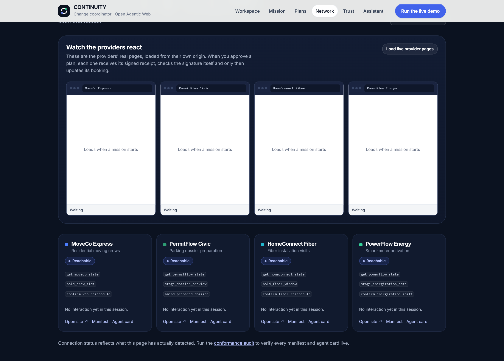

# CONTINUITY — Open Agentic Change Coordinator

**One change. Every commitment re-aligned.**

Built for the **[Cognizant Open Agentic Web Challenge](https://cognizant-agenticweb.devpost.com/)** · All 5 sites pass the official Cognizant validators (`build_network.mjs --check`, `check_partner.mjs`) for the **[Worldwide Agentic Web MVP Specification (Profile 0.2)](https://github.com/cognizant-ai-labs/agentic-web/blob/main/docs/worldwide_agentic_web_mvp_spec.md)**.




## Try it in 60 seconds (no API key needed)

1. Open **https://toskaman.github.io/continuity-agentic-web/?demo=1** — the demo starts by itself (or open the site and click **Run the live demo**).
2. CONTINUITY injects a real provider failure (MoveCo's Friday crew is full), recovers through an overflow partner, compares plans and holds replacements — your original bookings stay untouched.
3. The approval dialog lists every operation, price and provider. Click **Approve & commit**: three providers commit, three bookings stay untouched (two are never even contacted), and each commit returns an Ed25519-signed receipt.
4. The page scrolls to **Watch the providers react**: the four providers' real pages, framed from their own origin, each verify their signed receipt and show the new date (PowerFlow is correctly left unchanged).
5. Optional: **Try without a key** in *Ask CONTINUITY* runs the real agent networks, `website_*` tools and consent cards with a scripted model.

**Lighthouse 13.6 (desktop), all 5 live sites:** 100 Performance · 100 Accessibility · 100 Best Practices · 100 SEO · 100 Agentic Browsing — [details](docs/benchmarks/BROWSER_PERF_AND_MEMORY_AUDIT.md).

> Demo data: the four providers are independent demonstration services built for this challenge. No real bookings, payments or permits are touched.

## Live Public HTTPS Deployments (Verified Cross-Origin Ecosystem)

- **Primary Coordinator (`CONTINUITY`):** `https://toskaman.github.io/continuity-agentic-web/`
  - **Community Builder Kit (5 Zero-Backend Tools):** `https://toskaman.github.io/continuity-agentic-web/community-kit.html`
  - Public Manifest: `https://toskaman.github.io/continuity-agentic-web/agent-manifest.json`
  - Public Network JSON: `https://toskaman.github.io/continuity-agentic-web/continuity_coordinator.network.json`
  - Public Single-Turn Facts Network: `https://toskaman.github.io/continuity-agentic-web/facts/continuity_coordinator_facts.network.json`
  - Public NANDA AI Catalog: `https://toskaman.github.io/continuity-agentic-web/.well-known/ai-catalog.json`
  - Public A2A v1.0 Agent Card: `https://toskaman.github.io/continuity-agentic-web/.well-known/agent-card.json`
- **4 Independent Peer Websites (Distinct Origin `https://gpaschercher-sudo.github.io`):**
  - **Peer A — MoveCo Express:** `https://gpaschercher-sudo.github.io/moveco-agentic-peer/` (`moveco_dispatch`)
  - **Peer B — PermitFlow Civic Prep:** `https://gpaschercher-sudo.github.io/permitflow-agentic-peer/` (`permitflow_advisor`)
  - **Peer C — HomeConnect Fiber:** `https://gpaschercher-sudo.github.io/homeconnect-agentic-peer/` (`homeconnect_scheduler`)
  - **Peer D — PowerFlow Energy:** `https://gpaschercher-sudo.github.io/powerflow-agentic-peer/` (`powerflow_grid`)
- **Public Source Repository:** `https://github.com/toskaman/continuity-agentic-web`

---

## What CONTINUITY Does

When a real-world commitment changes (such as shifting a home relocation, an outpatient surgical procedure, or an international product-launch freight slot from Tuesday to Friday), **CONTINUITY**:
1. **Compiles Any Schedule (`.ics` Calendar, Raw Confirmation Emails, or Plain English)** via `@continuity/intake-compiler` and `@continuity/mission-core`, inferring typed semantic dependency edges while locking hard invariants (`maximum_budget_eur`, `preserve_existing_commitments = true`, `unauthorized_cancellation = false`).
2. **Analyzes Bounded Impact** over a typed dependency DAG — excluding unaffected commitments (`CityVault Pod` and `NordicLoom Saturday Delivery` receive zero unnecessary calls).
3. **Executes Across a Zero-Server Cross-Origin Browser Mesh (`@continuity/cross-origin-bridge`) + Dual WebMCP (`@continuity/webmcp-adapter`)** — connecting `toskaman.github.io` and `gpaschercher-sudo.github.io` in the visitor's browser via origin-verified `postMessage` capability bridges, WebCrypto Ed25519 signing, Cognizant Neuro SAN HOCON networks, W3C `navigator.modelContext` WebMCP tools, consent cards, and Hosted **Mozilla Otari** BYOK inference (`https://api.otari.ai/api/v1`).
4. **Solves Pareto-Optimal Minimal-Change Plans & Counterfactual Relaxations** (`Plan A — Minimum Changes`, `Plan B — Lowest Cost`, `Plan C — Fastest Alignment` + NSGA-II crowding distances, interactive What-If budget sweep, and **1-click Minimal Unsatisfiable Core counterfactual relaxation** when constraints conflict), recovering automatically from injected ripple failures (e.g., MoveCo's primary Friday crew full).
5. **Prepares First, Releases Safely, Commits Last, and Bridges Legacy Vendors** — placing reversible slot holds (`Release holds (€0)` keeps originals intact at zero cost), binding approvals with canonical SHA-256 digests (`€0.01` drift invalidates approval), reconciling `UNKNOWN` timeouts, verifying **Ed25519 provider receipts**, syncing top-level peer tabs via signed `#continuity_receipt` handoff tokens, generating **Hybrid Hold-First Reschedule Playbooks & `mailto:` Drafts (`@continuity/transition-playbook`)** for unagentified `.ics`/email vendors, and exporting + verifying **RFC 5545 `.ics` calendars** & **Zero-Trust Cryptographic Audit Bundles (`.json`)**.
6. **Publishes Single-Turn Public Facts (`facts/`) & Audits Any Open Agentic Website Live** — built-in **9-Point MVP Profile 0.2, Public Facts Network, & Project NANDA (`urn:air`, `ai-catalog.json`, `POST /resolve` `draft-raskar-02`, `agent-card.json`) Verifier** (`auditOpenAgenticSite` + `continuity-audit` CLI with `--json`, `--sarif`, and `--verify-bundle`), plus optional **Zero-Key On-Device AI (`@continuity/local-browser-router` — Chrome `LanguageModel` Gemini Nano & local Ollama)**.

---

## Quickstart (Node.js >= 22, Zero External Runtime Dependencies)

### 1. Start All 5 Independent Open Agentic Websites Locally

```bash
node scripts/serve_ecosystem.mjs
```

This starts five distinct origins with spec-compliant CORS and Sandbox Worker CSP headers:
- **CONTINUITY Coordinator:** `http://127.0.0.1:8080/` (`http://127.0.0.1:8080/continuity_coordinator`)
- **Peer A — MoveCo Express:** `http://127.0.0.1:8081/` (`http://127.0.0.1:8081/moveco_dispatch` + `/mcp`)
- **Peer B — PermitFlow Civic Prep:** `http://localhost:8082/` (`http://localhost:8082/permitflow_advisor` + `/mcp`)
- **Peer C — HomeConnect Fiber:** `http://127.0.0.1:8083/` (`http://127.0.0.1:8083/homeconnect_scheduler` + `/mcp`)
- **Peer D — PowerFlow Energy:** `http://localhost:8084/` (`http://localhost:8084/powerflow_grid` + `/mcp`)

*(Note: Linked sites alternate `127.0.0.1` and `localhost` locally as recommended by `skills/agentify-website/references/linking.md` so loopback BYOK cookies stay origin-isolated. After testing with a real API key locally, select **Delete setup** under `⚙ AI model settings → Advanced settings` and close the tab.)*

### 2. Run Full Compliance, Partner, Security & Chaos Test Gate

```bash
node scripts/run_all_tests.mjs
```

This single command executes:
1. Official Cognizant `build_network.mjs --check` across all 5 websites (**0 errors, 0 warnings**).
2. Official Cognizant `check_partner.mjs` across all **9 bidirectional cross-origin directions** (`CONTINUITY -> 4 Peers`, `All 4 Peers -> CONTINUITY`, and external open callability — **CORS, manifests, networks, and `bridge/action-bridge.html` verified**).
3. All **76 automated tests in 25 suites** (unit, runtime multi-provider SSE parallel tool calls & EU/US Otari + Gemini `AQ.` routing, 1-click OpenRouter OAuth PKCE S256 & URL `?code=` scrubbing, pre-execution peer instruction firewall & TOFU SHA-256 rug-pull pinning, zero-key on-device `LanguageModel` & loopback Ollama router, visible `data-agent-facts` anti-injection & `facts/` partner checks, Project NANDA `urn:air` + AI Catalog + Poppy `nandaindex.org/reach` v1 + `POST /resolve` `draft-raskar-02` + SPA fallback detection, NSGA-II Pareto + counterfactual relaxation + 6-day horizon sweep, NL `Month Day` / `+N days` & hybrid `.ics` intake, hybrid Open Agentic Web + legacy Hold-First transition playbook, zero-trust audit bundle verifier & `€0.01` tamper detection, `€0` pre-commit hold release, Google ADK → HOCON converter, mandate & Nash bargaining bypasses, SHA-256 hash-chained ledger, cross-origin browser bridge, peer zero-key replay, W3C `document.modelContext` + `navigator.modelContext` WebMCP guardrails, bidirectional `Engine` composition `I1–I3`, live 9-point MVP 0.2 + NANDA conformance auditor & SARIF CLI, production `--dry-run` bundle staging, docs-vs-code truth contract, provider MCP contracts, adversarial security boundaries, **real Headless Chromium CDP Desktop + `390x844` Mobile + `?demo=1` + `?ask_continuity=1` + Builder Kit E2E**, and all **24 Chaos Lab scenarios**).

### 3. Reproduce Before/After & Multi-Domain Benchmarks (`N = 90` Measured Sagas)

```bash
node scripts/run_benchmarks.mjs
```

---

## Repository Structure

```text
continuity/
├── apps/
│   ├── continuity-web/        # Primary Open Agentic Coordinator Website + SVG Graph + Chaos Lab
│   ├── demo-moveco/           # Peer A: Moving van crew & 15-min slot holds
│   ├── demo-permitflow/       # Peer B: Public curbside bay notice check & demo dossier drafts
│   ├── demo-homeconnect/      # Peer C: Fiber ONT technician scheduling & 10-min holds
│   └── demo-powerflow/        # Peer D: Remote smart-meter electricity energization
├── packages/                  # 22 Reusable Open-Source Community Modules (Apache-2.0)
│   ├── shared-schemas/        # Canonical JSON (JCS), SHA-256 Web Crypto, strict JSON Schema
│   ├── mission-core/          # Mission compiler & hard-invariant guard
│   ├── intake-compiler/       # Email + Hybrid RFC 5545 .ics + JSON compiler & Audit Bundle verifier
│   ├── transition-playbook/   # Hybrid Agentic-Web + Legacy Vendor Hold-First Playbook & mailto: drafts
│   ├── peer-firewall/         # Pre-execution peer instruction firewall, Bidi Trojan & TOFU SHA-256 guard
│   ├── openrouter-pkce/       # Zero-client-ID RFC 7636 S256 1-click OpenRouter OAuth PKCE onboarding
│   ├── adk-hocon-converter/   # Google ADK / OpenAI Agents -> Portable Neuro SAN HOCON converter
│   ├── local-browser-router/  # Zero-key Chrome LanguageModel (Gemini Nano) & loopback Ollama router
│   ├── facts-publisher/       # Visible data-agent-facts extractor & 1-turn facts/<network>_facts builder
│   ├── mission-graph/         # Open Mission Graph with 3-color DFS cycle rejection & DAG layout
│   ├── impact-engine/         # Bounded incremental dependency impact analyzer
│   ├── capability-adapter/    # Peer semantic normalization & untrusted response validation
│   ├── constraint-solver/     # Pareto optimizer, NSGA-II crowding & counterfactual MUS relaxation
│   ├── mandate-arbiter/       # Policy-bound SHA-256 mandates & sealed-bid integer-cent Nash arbiter
│   ├── cross-origin-bridge/   # Zero-server cross-origin postMessage RPC & signed Ed25519 handoff
│   ├── webmcp-adapter/        # Dual Cognizant website_* + W3C navigator.modelContext WebMCP bridge
│   ├── approval-engine/       # Canonical SHA-256 bound approvals & TOCTOU replay guard
│   ├── outcome-reconciliation/# 14-state SHA-256 hash-chained ledger & UNKNOWN timeout reconciler
│   ├── saga-engine/           # Prepare-first, €0 hold-release, commit-last Saga coordinator
│   ├── proof-verifier/        # Ed25519 receipt verification & explicit trust classification
│   ├── nanda-resolver/        # Project NANDA AI Catalog, POST /resolve, A2A & 9-point CLI/SARIF auditor
│   └── chaos-lab/             # 24 deterministic failure-injection scenarios
├── providers/                 # Standalone CORS + MCP (2025-06-18) servers for each peer
├── skills/agentify-website/   # Official Cognizant runtime & compliance validators
├── design-system/             # Shared tokens, components, per-site themes (built by scripts/write_peer_styles.mjs)
├── scripts/                   # Ecosystem launcher, validator, origin rewriter & benchmark suite
├── tests/                     # Unit, Contract, Integration, Security & Chaos tests
└── docs/                      # Compliance audit, architecture, threat model, benchmarks, Devpost
```

---

## Public Static Hosting Headers (`_headers`)

When deploying any `apps/*` bundle to a public HTTPS host (Netlify, Cloudflare Pages, GitHub Pages, S3/CloudFront), configure `scripts/configure_origins.mjs` with the HTTPS URLs and serve:
- `Access-Control-Allow-Origin: *` on `/agent-manifest.json`, `/<network>.network.json`, `/links.json`, `/agent-mcp.json`, `/.well-known/nsdeploy.json`, and `/.well-known/nsdeploy-agent.json`.
- `Content-Security-Policy: default-src 'none'; script-src blob:; connect-src 'none'; worker-src 'none'` on `/runtime/sandbox-worker.js`.
- Do **not** block framing (`X-Frame-Options`) on `/bridge/action-bridge.html`.

---

## Documentation Index

- [Final Readiness Report — honest internal assessment](docs/competition/FINAL_READINESS_REPORT.md)
- [Earlier audit (pre-redesign, historical)](docs/competition/TITAN_V3_DOMINATION_REPORT.md)
- [24-Month Global Hackathon Winner Intelligence (2024–2026)](docs/research/GLOBAL_HACKATHON_WINNER_INTELLIGENCE_2024_2026.md)
- [Official Competition Compliance Audit](docs/competition/COMPLIANCE_AUDIT.md)
- [Technical Architecture & Topology](docs/architecture/ARCHITECTURE.md)
- [Initial Reconnaissance & Spec Analysis](docs/architecture/INITIAL_RECONNAISSANCE.md)
- [Competitive Landscape Analysis](docs/research/COMPETITIVE_ANALYSIS.md)
- [Threat Model, Security & Privacy](docs/security/THREAT_MODEL.md)
- [Chaos Lab Catalog (20 Scenarios)](docs/CHAOS_TEST_CATALOG.md)
- [Measured Before/After Benchmarks](docs/benchmarks/BEFORE_AFTER.md)
- [Live-Model Check (real Otari model, nothing mocked)](docs/benchmarks/LIVE_MODEL_CHECK.md)
- [Chromium Performance Trace & V8 Heap Audit](docs/benchmarks/BROWSER_PERF_AND_MEMORY_AUDIT.md)
- [Three-Judge Red-Team Review](docs/competition/RED_TEAM_JUDGE_REVIEW.md)
- [Complete Pitch Suite & Tough Judge Q&A](docs/submission/PITCH_AND_JUDGE_QA_DECK.md)
- [Video Production Bible & QC Report](docs/video-production/VIDEO_QC_AND_REVIEW_REPORT.md)
- [Devpost Submission Draft](docs/submission/DEVPOST_SUBMISSION.md)
- [Human-Narrated Video Recording Script (< 2 min)](docs/submission/VIDEO_RECORDING_SCRIPT.md)
- [Design System](design-system/README.md)

---

## Honest Disclosures & License

- **Demonstration Providers:** `MoveCo`, `PermitFlow`, `HomeConnect`, and `PowerFlow` are independent demonstration services created for the Open Agentic Web Challenge. `PermitFlow` prepares demonstration application drafts only and never accesses or mutates municipal government databases.
- **Privacy & External LLM Routing:** Visitor messages and local `website_*` read outputs are sent only to the LLM router configured by the visitor in `⚙ AI model settings` (default: Hosted Mozilla Otari). Partner peer networks run locally in the visitor's browser and never receive the visitor's API key.
- **License:** Apache License 2.0 (`LICENSE`), preserving upstream Apache-2.0 notices for Cognizant's `agentic-web` / `nsdeploy` browser runtime.
