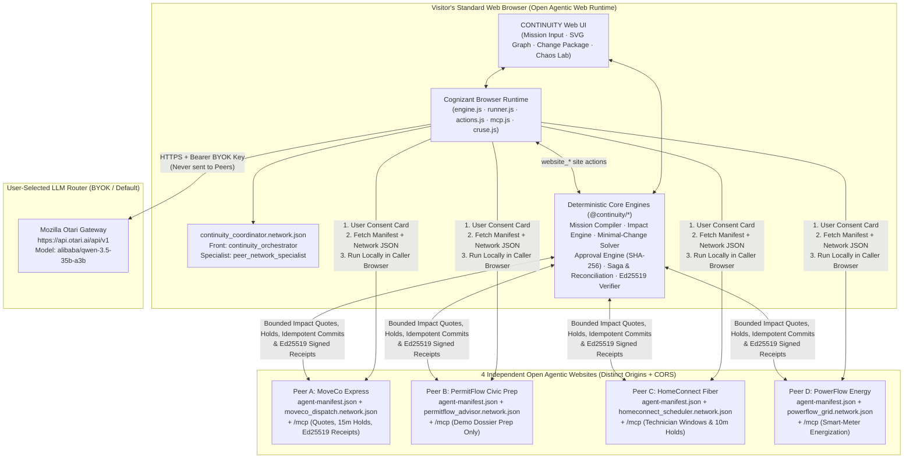

# Technical Architecture — CONTINUITY

## 1. System Topology Diagram

---

## 2. Architectural Separation of Concerns

### 2.1 Probabilistic Layer vs. Deterministic Safety Kernel
- **Probabilistic Layer (Neuro SAN HOCON Agents):** Interprets natural-language requests, delegates cross-origin informational queries across partner networks after visitor consent, and renders CRUSE summaries.
- **Deterministic Safety Kernel (`packages/*`):**
  1. `@continuity/shared-schemas` — Strict JSON Schema validator, prototype-pollution blocker, RFC-8785-style canonical JSON serializer, and Web Crypto SHA-256 digest.
  2. `@continuity/mission-core` — Validates change proposals and prevents any downgrade of hard invariants (`maximum_budget_eur <= €700`, `preserve_existing_commitments = true`, `unauthorized_cancellation = false`).
  3. `@continuity/mission-graph` — Acyclic typed commitment graph separating observed provider facts from dependency semantics (`SAME_DAY_REQUIRED`, `ON_OR_AFTER`, `ON_OR_BEFORE`, `WITHIN_COVERAGE_SPAN`).
  4. `@continuity/impact-engine` — Bounded BFS impact propagation that excludes unaffected commitments (`CityVault Pod` and `NordicLoom Delivery` receive zero network calls).
  5. `@continuity/capability-adapter` — Normalizes heterogeneous provider schemas while preserving operational flags (`supports_hold`, `reversible`, `creates_final_booking`).
  6. `@continuity/constraint-solver` — Reproducible weighted multi-objective optimizer generating `PLAN_A_MINIMAL_CHANGE`, `PLAN_B_LOWEST_COST`, and `PLAN_C_FASTEST_RESOLUTION`.
  7. `@continuity/approval-engine` — Binds human consent to canonical operation parameters via SHA-256 and blocks replay or `€0.01` price drift.
  8. `@continuity/outcome-reconciliation` & `@continuity/saga-engine` — 14-state explicit state machine (`DRAFT` -> `PREPARED` -> `AWAITING_APPROVAL` -> `APPROVED` -> `DISPATCHED` -> `UNKNOWN` / `RECONCILING` -> `COMMITTED` / `NEEDS_USER`) implementing **Prepare-First, Commit-Last** execution.
  9. `@continuity/proof-verifier` — Verifies Ed25519 provider receipts against pinned demonstration public JWKs.
  10. `@continuity/chaos-lab` — 15 deterministic fault-injection scenarios runnable via CLI or browser tab.

---

## 3. Open Agentic Web Compliance Details

Every one of the 5 websites (`apps/continuity-web`, `apps/demo-moveco`, `apps/demo-permitflow`, `apps/demo-homeconnect`, `apps/demo-powerflow`) publishes:
- `/agent-manifest.json` (`Access-Control-Allow-Origin: *`)
- `/<network>.network.json` (`Access-Control-Allow-Origin: *`)
- `/links.json` (`Access-Control-Allow-Origin: *`)
- `/agent-mcp.json`, `/.well-known/nsdeploy.json`, `/.well-known/nsdeploy-agent.json` (`Access-Control-Allow-Origin: *`)
- `/bridge/action-bridge.html` & `/bridge/agent-manifest.json` (frameable, zero exposed local page code)
- `/runtime/*` (with strict `Content-Security-Policy` on `/runtime/sandbox-worker.js`)
