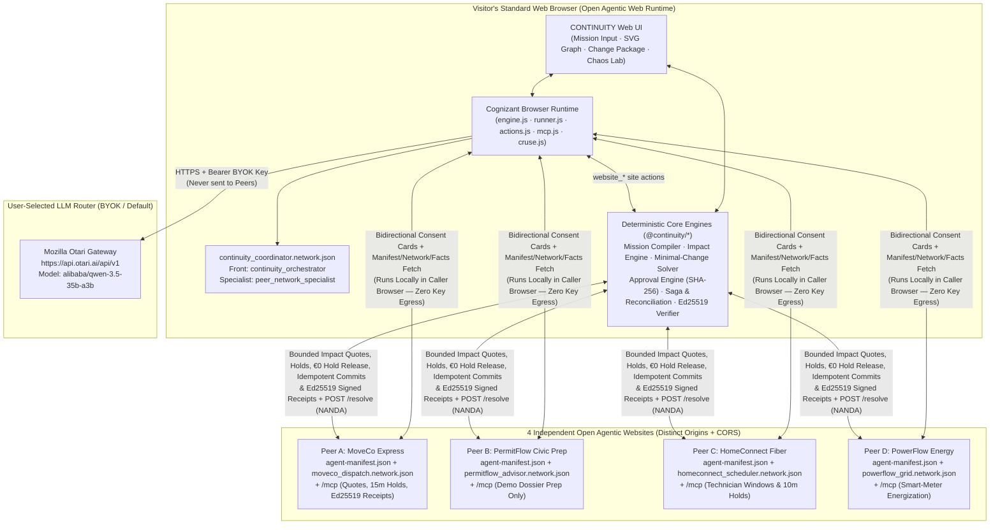

# Technical Architecture — CONTINUITY

## 1. System Topology Diagram

---

## 2. Architectural Separation of Concerns

### 2.1 Probabilistic Layer vs. Deterministic Safety Kernel
- **Probabilistic Layer (Neuro SAN HOCON Agents):** Interprets natural-language requests, delegates cross-origin informational queries across partner networks after visitor consent, and renders CRUSE summaries.
- **Deterministic Safety Kernel (`packages/*` — 22 Zero-Dependency Apache-2.0 Modules):**
  1. `@continuity/shared-schemas` — Strict JSON Schema validator, prototype-pollution blocker, RFC-8785-style canonical JSON serializer, and Web Crypto SHA-256 digest.
  2. `@continuity/mission-core` — Compiles natural-language requests (ISO dates, weekdays, `Month Day`, `+N days`) and prevents any downgrade of hard invariants (`maximum_budget_eur`, `preserve_existing_commitments = true`, `unauthorized_cancellation = false`).
  3. `@continuity/intake-compiler` — Compiles folded RFC 5545 `.ics` calendars, confirmation emails, and JSON booking arrays; exports `.ics` and verifies `continuity-verifiable-audit-bundle/v1` offline.
  4. `@continuity/adk-hocon-converter` — Translates `LlmAgent` / `sub_agents` graphs into portable Neuro SAN `.network.json` + `agent-manifest.json`, scrubbing leaked keys and rejecting cycles.
  5. `@continuity/local-browser-router` — Zero-key Chrome Built-in `LanguageModel` (Gemini Nano) JSON-Schema tool-calling adapter & safe loopback Ollama probe.
  6. `@continuity/facts-publisher` — Extracts visitor-visible `data-agent-facts` DOM elements, rejects hidden/folded/form injection vectors, and compiles single-turn `facts/<network>_facts` bundles.
  7. `@continuity/mission-graph` — Acyclic typed commitment graph separating observed provider facts from dependency semantics (`SAME_DAY_REQUIRED`, `ON_OR_AFTER`, `ON_OR_BEFORE`, `WITHIN_COVERAGE_SPAN`).
  8. `@continuity/impact-engine` — Bounded BFS impact propagation that excludes unaffected commitments (`CityVault Pod` and `NordicLoom Delivery` receive zero network calls).
  9. `@continuity/capability-adapter` — Normalizes heterogeneous provider schemas while preserving operational flags (`supports_hold`, `reversible`, `creates_final_booking`).
  10. `@continuity/constraint-solver` — 4-objective Pareto optimizer with NSGA-II crowding distances and Minimal Unsatisfiable Core counterfactual relaxation (`computeMinimalCounterfactualRelaxation`).
  11. `@continuity/mandate-arbiter` — Frozen SHA-256 policy mandates, outbound budget redaction, and integer-cent sealed-bid Nash bargaining arbiter.
  12. `@continuity/cross-origin-bridge` — Zero-server cross-origin `postMessage` RPC, origin-isolated WebCrypto Ed25519 keys, and verified `#continuity_receipt` handoffs.
  13. `@continuity/webmcp-adapter` — Exposes site actions to both Neuro SAN `website_*` tools and W3C `navigator.modelContext` (WebMCP) with confirmation gates.
  14. `@continuity/approval-engine` — Binds human consent to canonical operation parameters via SHA-256 and blocks replay or `€0.01` price drift.
  15. `@continuity/outcome-reconciliation` & 16. `@continuity/saga-engine` — 14-state SHA-256 hash-chained ledger implementing **Prepare-First, `€0` Hold-Release, Commit-Last** execution and `UNKNOWN` reconciliation.
  17. `@continuity/proof-verifier` — Verifies Ed25519 provider receipts against pinned demonstration public JWKs.
  18. `@continuity/nanda-resolver` — Project NANDA `urn:air:` validator, `ai-catalog.json` & A2A v1.0 checks, Poppy `nandaindex.org/reach` v1 post-tab locator router, `POST /resolve` (`draft-raskar-02` §6), SPA fallback detection, and 9-point SARIF/bundle-verifier CLI.
  19. `@continuity/transition-playbook` — Hybrid Open Agentic Web + Legacy Vendor Hold-First execution playbook & `mailto:` reschedule draft generator solving cold-start mixed schedules.
  20. `@continuity/peer-firewall` — Pre-execution peer instruction firewall, Unicode Bidi/zero-width Trojan scanner, and TOFU JCS SHA-256 rug-pull re-consent pinning.
  21. `@continuity/openrouter-pkce` — Zero-client-ID RFC 7636 S256 1-click OpenRouter OAuth PKCE onboarding & URL `?code=` scrubber.
  22. `@continuity/chaos-lab` — 24 deterministic fault-injection scenarios runnable via CLI or browser tab.

---

## 3. Open Agentic Web Compliance Details

Every one of the 5 websites (`apps/continuity-web`, `apps/demo-moveco`, `apps/demo-permitflow`, `apps/demo-homeconnect`, `apps/demo-powerflow`) publishes:
- `/agent-manifest.json` (`Access-Control-Allow-Origin: *`)
- `/<network>.network.json` (`Access-Control-Allow-Origin: *`)
- `/facts/agent-manifest.json`, `/facts/<network>_facts.network.json`, `/facts/links.json` (`Access-Control-Allow-Origin: *`)
- `/links.json` (`Access-Control-Allow-Origin: *`)
- `/agent-mcp.json`, `/.well-known/nsdeploy.json`, `/.well-known/nsdeploy-agent.json` (`Access-Control-Allow-Origin: *`)
- `/agent-card.json`, `/.well-known/agent-card.json`, `/ai-catalog.json`, `/.well-known/ai-catalog.json` (`Access-Control-Allow-Origin: *`)
- `/bridge/action-bridge.html` & `/bridge/agent-manifest.json` (frameable, zero exposed local page code)
- `/runtime/*` (with strict `Content-Security-Policy` on `/runtime/sandbox-worker.js`)
- Plus standalone 5-tool Community Builder Kit at `/community-kit.html` on `continuity-web`.
